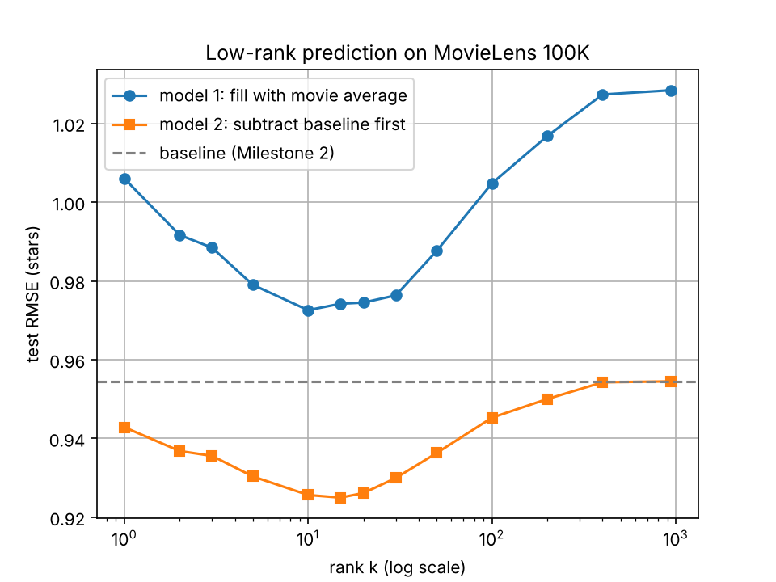

# recommendation_system
Movie recommendation system project for MATH 344L using linear algebra and the MovieLens 100K dataset.
#milestone 2
This project uses the MovieLens 100K dataset, which contains 100,000 movie ratings from 943 users across 1,682 movies. The dataset is downloaded automatically when the notebook runs and is not stored in the repository.

**Citation:** Harper, F. M., & Konstan, J. A. (2015). The MovieLens Datasets: History and Context. *ACM Transactions on Interactive Intelligent Systems, 5*(4), Article 19. https://doi.org/10.1145/2827872

#milestone 3
`notebooks/03_low_rank.ipynb` uses the SVD (best rank-k approximation) to fill in missing ratings. Results on the same hidden test ratings as Milestone 2:

| Model | Best test RMSE (stars) |
|---|---|
| baseline (Milestone 2) | 0.9545 |
| model 1: fill with movie average, k = 10 | 0.9726 |
| model 2: subtract baseline first, k = 15 | 0.9250 |
| model 3: iterative SVD, k = 5 | 0.9206 |

